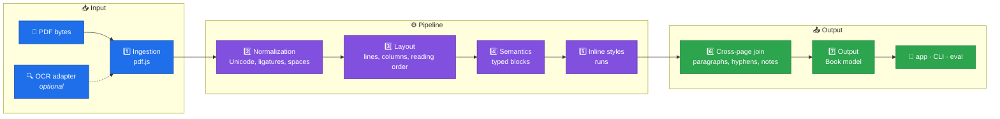

<div align="center">

# 📖 PagePace

### PDF in, reflowable text out

*PagePace rebuilds a PDF as a structured, reflowable document — paragraphs, headings, notes and styles — and reads it back as text instead of showing the PDF page.*

[**Leia em português**](README.pt-BR.md)

<!-- hero image goes here -->


</div>

---

## 📑 Index

| | |
|---|---|
| [🎯 The problem](#-the-problem) | [📈 Quality](#-quality) |
| [🏗️ Architecture](#️-architecture) | [📁 Repository structure](#-repository-structure) |
| [⚡ Quick start](#-quick-start) | [🗺️ Roadmap](#️-roadmap) |
| [🖥️ The CLI](#️-the-cli) | [🛠️ How it is built](#️-how-it-is-built) |
| [📚 Documentation](#-documentation) | [🙏 Acknowledgments](#-acknowledgments) |

---

## 🎯 The problem

PDFs are made for print, not for deep reading. On a phone they are worse: zoom, pan, lose your place. The table below lists what goes wrong with a PDF page and what the extractor does about it today.

| 🔴 The PDF as printed | ✅ What PagePace does |
|---|---|
| **Fixed pages** — every page is a canvas of a fixed size; on a phone the text is either tiny or cut off | Text becomes typed blocks in reading order; page geometry survives only as `origin` metadata, so the text can reflow to any screen (the reader app is still planned) |
| **Columns** — two or three columns read line by line across the gutter, in the wrong order | Up to three columns are detected per page and read in the correct reading order |
| **Notes at the bottom** — footnotes sit at the foot of the page, far from the call that points to them | `footnote` blocks are linked to their call (`anchor` and `noteRef`) |
| **Hyphenation** — words are broken by hyphens at line breaks, and paragraphs are cut by page turns | Cross-page joins rebuild hyphenated words and paragraphs; genuine hyphens of compound words are kept |
| **Repeated headers** — running heads, footers and page numbers repeat inside the text flow | Repeated regions are removed from the flow, and side regions stay out of the body |

> [!NOTE]
> **Status:** the extractor (`packages/extractor`, phases E0–E10) and the segmenter (`packages/segmenter`, phase SEG) are complete and tested. The reading app (`apps/reader`) has **not started** — it is planned as milestones M0–M6. Today PagePace is a library and a CLI.

> [!IMPORTANT]
> **No copyrighted PDF in this repository.** Public test PDFs are downloaded by a script, never committed; the only committed PDFs are the two CC BY 4.0 SciELO articles in `corpus/vendored/`. Copyrighted books live **outside** the repository, in the folder named by `CORPUS_PRIVATE_DIR`. Never attach a copyrighted PDF or its text to a commit, issue or pull request.

---

## 🏗️ Architecture

The seven layers of the extractor — each one a pure function with explicit types, testable alone with small fixtures:



The `Book` is the contract between the extractor and everything else: typed blocks with stable IDs, inline styles, page origin, confidence and flags. Details: [docs/extractor/ARCHITECTURE.md](docs/extractor/ARCHITECTURE.md) and [docs/extractor/SCHEMA.md](docs/extractor/SCHEMA.md).

---

## ⚡ Quick start

Requirements: **Node >= 24** (the exact version is in [`.nvmrc`](.nvmrc)) and **pnpm 9.15.0** (pinned in the `packageManager` field of [`package.json`](package.json)).

```bash
pnpm install --frozen-lockfile
pnpm corpus:fetch   # the first run downloads the public test PDFs
pnpm verify         # typecheck, lint, format, tests, no-PDF check, docs budget
```

The public corpus is described in [corpus/README.md](corpus/README.md); the private folder is optional.

---

## 🖥️ The CLI

```bash
pnpm --silent pagepace inspect corpus/vendored/n3-pt-scielo-wittgenstein.pdf --pages 2-2
```

The report below is the first 12 lines of a real run:

```text
Arquivo: corpus/vendored/n3-pt-scielo-wittgenstein.pdf
Páginas medidas: 11 de 11
Itens de texto: 967
Páginas no relatório: 2
Corpo (moda ponderada): 12.00 pt
Entrelinha típica: 14.40 pt
Margens: topo 34.76 pt · direita 56.51 pt · base 37.21 pt · esquerda 56.69 pt
Largura de coluna: 482.19 pt

== Página 2 (7 bloco(s)) ==
[p1-b0-16717eaf] paragraph · páginas 2 · confiança 0.90 · flags: nenhuma
Descartes, instado por objetores, esclarecia a função metódica da dúvida através de uma analogia bastante eloquente: "Se vós tivésseis um cesto de maçãs dentre as quais várias estivessem podres, contaminando assim as restantes, o que fazer senão esvaziá-lo todo e, tomando cada maçã, uma a uma, recolocar as boas no cesto e jogar fora as más?" (Respostas às sétimas objeções, p. 324). Ou seja, a ideia é que o ceticismo epistemológico cumpre uma espécie de função profilática, funcionando como um filtro que é útil para separar o que é verdadeiro e certo do que é falso e duvidoso.
```

`extract` prints the whole `Book` as JSON. This excerpt is a real run, cut at 15 lines, showing the end of one block and the start of the next:

```bash
pnpm --silent pagepace extract corpus/vendored/n3-pt-scielo-wittgenstein.pdf > book.json
```

```json
        "originalPageLabel": "1"
      },
      "confidence": 0.9,
      "flags": []
    },
    {
      "id": "p0-b0-645288ef",
      "kind": "heading",
      "level": 1,
      "runs": [
        {
          "text": "Artigo",
          "bold": true,
          "sup": true
        }
```

The CLI output is in **Portuguese**. "Wittgenstein e o ceticismo" by Daniel Temp, *Filosofia Unisinos* 27(1) (2026), e27103, DOI [10.4013/fsu.2026.271.03](https://doi.org/10.4013/fsu.2026.271.03) — © the authors, licensed under [CC BY 4.0](https://creativecommons.org/licenses/by/4.0/). The file is a byte-for-byte copy in `corpus/vendored/`; details in [THIRD_PARTY.md](THIRD_PARTY.md).

> [!TIP]
> Use `pnpm --silent` to hide the pnpm banner, so only the report or the JSON reaches the terminal.

> [!WARNING]
> A PDF with no text layer is refused by the default path (`ScannedPdfError`). OCR is optional: `pnpm pagepace extract file.pdf --ocr` uses the Tesseract adapter. Text coming from an embedded OCR layer is extracted with reduced confidence and a warning, because the characters may be wrong.

---

## 📈 Quality

`pnpm eval` measures the extractor against golden documents. This is the output of a real run with only the public corpus (no private folder configured) — exactly what a fresh clone reproduces:

```text
PagePace evaluation - 16 documents (16 public, 0 private), 12 with golden, 12 measured

By level (mean of the measured documents)
level  documents  measured  text_cer (mean)  style_f1 (mean)
-----  ---------  --------  ---------------  ---------------
N1             5         4           0.0000           1.0000
N2             6         5           0.0000           1.0000
N3             5         3           0.0000           0.9983
```

- **Golden tests** are expected-output JSON files (`corpus/golden/*.golden.json`) for documents whose specification *is* the truth — the 12 synthetic `syn-*` PDFs, generated by `pnpm corpus:synthetic`. Every metric compares the extraction against them.
- **Baseline and the no-regression rule:** [packages/eval/baseline.json](packages/eval/baseline.json) records the accepted value of every metric per document. `pnpm eval --ci` (run by CI on every pull request) **fails if any metric gets worse by more than 0.002**.
- A deliberate worsening needs an ADR in [docs/extractor/DECISIONS.md](docs/extractor/DECISIONS.md) and an explicit baseline update. Every other metric is `1.0000` on the 12 measured documents, except `style_f1` on `syn-n3-en-quotes` (`0.9950`), which sets the N3 mean at `0.9983`.

---

## 📁 Repository structure

```text
PagePace/
├── 📦 packages/            workspace packages
│   ├── schema/             the data contract: RawDocument, Book, Anchor, Overlay
│   ├── extractor/          the seven-layer pipeline, PDF to Book
│   ├── segmenter/          deterministic sentences and words, pt and en
│   ├── eval/               corpus runner, metrics and the baseline gate
│   └── cli/                pagepace extract · inspect · explain-page · eval
├── 📱 apps/                the reading app — planned, not started
├── 📚 corpus/              manifest, goldens, sentences, vendored CC BY PDFs
├── 📖 docs/                planning, phases, ADRs and the workflow
├── 🧪 tests/manual/        visual checklists a human runs at milestone ends
├── 🤖 .opencode/           reusable skills (recipes) for the AI agents
├── ⚙️ scripts/             small repository utilities
└── 🔧 .github/             CI workflow, issue and pull-request templates
```

---

## 🗺️ Roadmap

- [x] **Extractor** — phases E0–E10 closed: seven layers, typed blocks, inline styles, cross-page joins, footnotes, confidence and flags
- [x] **Segmenter** — phase SEG closed: deterministic sentences and words for Portuguese and English
- [ ] **M0 · Spikes and architecture** — decide desktop target (site vs. local), storage and TTS; write the phase plans for M1–M6
- [ ] **M1 · App shell** — TypeScript + Capacitor project, library, add a PDF → extract (streaming) → save the `Book`; themes
- [ ] **M2 · Dynamic reading (phone)** — preparation screen, word by word with ORP and proportional pace, sentence/paragraph/page chunks, controls, pause, save position
- [ ] **M3 · Normal reading + annotations** — paginator, subpages, highlight/underline/annotation, autosave, focus ruler, correction screen
- [ ] **M4 · Desktop** — two-page layout, bottom context while reading, shortcuts, annotation hover
- [ ] **M5 · TTS** — TTS adapter, word highlighting, speed; evaluate a local voice
- [ ] **M6 · Extras** — OCR, pacer-fade, optional Bionic, Markdown export of annotations, sync

The app milestones are defined in [docs/app/ROADMAP.md](docs/app/ROADMAP.md); each one will be broken into phases and atomic tasks during M0.

---

## 🛠️ How it is built

| Pillar | In practice | Where |
|---|---|---|
| **ADRs** | Every choice between alternatives, dependency or accepted trade-off is written down, so the next contributor reads the *why*, not a guess | [docs/extractor/DECISIONS.md](docs/extractor/DECISIONS.md) |
| **CI gates** | Lint, format, typecheck, the full test suite, the no-PDF check, the docs budget, `pnpm eval --ci` (metric regression gate) and `pnpm bench --ci` (speed and memory alarm) | [.github/workflows/ci.yml](.github/workflows/ci.yml) |
| **Metrics** | Extraction changes are accepted only if the corpus evaluation does not regress beyond the 0.002 tolerance | [docs/extractor/EVALUATION.md](docs/extractor/EVALUATION.md) |

The process is in [docs/WORKFLOW.md](docs/WORKFLOW.md): small atomic tasks, test first when possible, `pnpm verify` green, pull request, squash merge. Contributing rules: [CONTRIBUTING.md](CONTRIBUTING.md).

---

## 📚 Documentation

Everything under `docs/` is written in Portuguese. The table below points to each map.

<details>
<summary><b>📖 Documentation map</b></summary>

| I want to… | Read |
|---|---|
| Understand the project | [docs/extractor/PROJECT.md](docs/extractor/PROJECT.md) |
| Understand the extractor | [docs/extractor/ARCHITECTURE.md](docs/extractor/ARCHITECTURE.md), [docs/extractor/SCHEMA.md](docs/extractor/SCHEMA.md) |
| See the plan | [docs/extractor/ROADMAP.md](docs/extractor/ROADMAP.md), phases in `docs/extractor/phases/` |
| See how quality is measured | [docs/extractor/EVALUATION.md](docs/extractor/EVALUATION.md), [corpus/README.md](corpus/README.md) |
| See why decisions were taken | [docs/extractor/DECISIONS.md](docs/extractor/DECISIONS.md) (ADR log) |
| Understand the working process | [docs/WORKFLOW.md](docs/WORKFLOW.md), [AGENTS.md](AGENTS.md) |
| Understand the app plan | [docs/app/PROJECT.md](docs/app/PROJECT.md), [docs/app/ROADMAP.md](docs/app/ROADMAP.md) |
| Contribute | [CONTRIBUTING.md](CONTRIBUTING.md) |

Start at [docs/README.md](docs/README.md).

</details>

<details>
<summary><b>⚠️ Known limits</b></summary>

- `figure`, `table` and `equation` blocks are detected and carried as **placeholders** (no runs) — their content is not reconstructed yet.
- A PDF with **no text layer** fails the default path (`ScannedPdfError`); OCR is an opt-in ingestion adapter (`ingestOcrFlow`, `pagepace extract --ocr`).
- Text coming from an **embedded OCR layer** is extracted with reduced confidence and a warning.
- The **reader app** is not started: there is no screen to read a `Book` on yet.

</details>

<details>
<summary><b>🗂️ Repository map</b></summary>

| Path | What it is |
|---|---|
| `packages/` | `schema` (the contract), `extractor`, `segmenter`, `eval`, `cli` |
| `apps/` | the reader app — planned, not started ([docs/app/ROADMAP.md](docs/app/ROADMAP.md)) |
| `corpus/` | test documents: manifest, goldens, vendored CC BY PDFs (public PDFs are downloaded, never committed) |
| `docs/` | planning and process documentation, in Portuguese |
| `scripts/` | small repository utilities (docs budget, e-mail policy, pdf.js assets) |
| `tests/manual/` | visual checklists a human runs at the end of each milestone |
| `.opencode/` | skills (reusable recipes) for the AI agents working here |
| `.github/` | CI workflow, issue and pull-request templates |

</details>

---

## 🙏 Acknowledgments

- [pdf.js](https://mozilla.github.io/pdf.js/) (Apache-2.0) — PDF ingestion, runs in the browser and in Node.
- [tesseract.js](https://github.com/naptha/tesseract.js) (Apache-2.0) — OCR engine adapter.
- [zod](https://zod.dev/) (MIT) — runtime validation of the data contract.
- [Source Serif 4](https://adobe-fonts.github.io/source-serif/) (SIL OFL 1.1) — test fonts used by the test suite.
- Daniel Temp and Milene Consenso Tonetto, authors of the two CC BY 4.0 SciELO articles used as test fixtures.

Licenses and attributions for everything that lives in or ships with this repository: [THIRD_PARTY.md](THIRD_PARTY.md).

---

**PagePace** · [MIT License](LICENSE) · 2026
