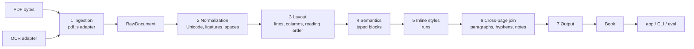

# PagePace

[Leia em português](README.pt-BR.md)

PagePace rebuilds a PDF as a structured, reflowable document and reads it back as text — paragraphs, headings, notes and styles — instead of showing the PDF page.

[](https://github.com/Rennan-aex/PagePace/actions/workflows/ci.yml)
[](LICENSE)
[](.nvmrc)

## Status

| Component | State |
|---|---|
| `packages/extractor` (PDF → model) | **Complete and tested** — phases E0–E10 closed, see [docs/extractor/ROADMAP.md](docs/extractor/ROADMAP.md) |
| `packages/segmenter` (sentences and words, pt/en) | **Complete and tested** — SEG phase closed |
| `apps/reader` (the reading app) | **Not started** — planned only, see [docs/app/ROADMAP.md](docs/app/ROADMAP.md) |

The numbers on this page come from real runs of the commands shown (`pnpm eval`, `pnpm verify`) on a development machine; nothing here is hand-written.

## Why

PDFs are made for print, not for deep reading: fixed pages, two columns, footnotes at the bottom, lines broken by hyphens, headers repeated on every page. On a phone they are worse — zoom, pan, lose your place.

PagePace extracts the PDF **once** into an intermediate model (`Book`: typed blocks with inline styles, stable IDs, confidence) and every reading mode consumes that model. The PDF page is never rendered to the reader; the text can reflow to any screen, and reader corrections (merge, split, retype) live in a separate overlay that survives re-extraction.

## What the extractor recognizes

Only what the code does today — checked against [docs/extractor/ARCHITECTURE.md](docs/extractor/ARCHITECTURE.md) and [docs/extractor/SCHEMA.md](docs/extractor/SCHEMA.md):

- **Block types** (`BlockKind`): `heading` (levels 1–6), `paragraph`, `blockquote`, `epigraph`, `list_item`, `footnote` (linked to its call), `reference`, `caption`, `figure`, `table`, `equation`, `code`, `margin_ref` (editorial numbering such as Bekker/Stephanus, kept out of the reading flow).
- **Layout**: text lines, up to three columns with reading order, repeated regions (headers, footers, page numbers) removed from the flow, sidebars, and cross-page joins for paragraphs and hyphenated words.
- **Inline styles**: bold, italic, superscript, subscript and small caps recovered from font names and flags; Greek/Latin fragments tagged with `lang`.
- **Document level**: table of contents from the PDF bookmarks, title/authors/language metadata, and per-block `confidence` plus `flags` for every reason to doubt.
- **Honest limits**: `figure`, `table` and `equation` blocks are detected and carried as *placeholders* (no runs) — their content is not reconstructed yet. A scanned PDF with no text layer is rejected (`ScannedPdfError`, waiting for OCR); text coming from an embedded OCR layer is extracted with reduced confidence and a warning.

## Architecture

The seven layers of [docs/extractor/ARCHITECTURE.md](docs/extractor/ARCHITECTURE.md) — each one a pure function with explicit types:



## Quick start

Requirements: **Node >= 24** (the exact version is in [`.nvmrc`](.nvmrc)) and **pnpm 9** (pinned in the `packageManager` field of [`package.json`](package.json)).

```bash
pnpm install --frozen-lockfile   # 0.8 s (already-installed run)
pnpm corpus:fetch                # 1.9 s (16 files cached, no download)
pnpm verify                      # 41.6 s: typecheck, lint, format, 1406 tests, no-PDF check, docs budget
```

Times measured on this machine with everything already installed (`pnpm install` prints "Done in 684ms"; `corpus:fetch` reports `16 public (… 16 reused)`). The **first** `pnpm corpus:fetch` downloads the public test corpus over the network and takes longer; later runs only verify the SHA-256 of each file. `pnpm verify` must be green before any pull request — see [CONTRIBUTING.md](CONTRIBUTING.md).

## Example: the CLI on a corpus PDF

```bash
pnpm --silent pagepace inspect corpus/vendored/n3-pt-scielo-wittgenstein.pdf --pages 2-2
```

First 12 lines of a real run (`--silent` hides the pnpm banner so only the report reaches the terminal):

```text
Arquivo: corpus/vendored/n3-pt-scielo-wittgenstein.pdf
Páginas medidas: 11 de 11
Itens de texto: 967
Páginas no relatório: 2
Corpo (moda ponderada): 12.00 pt
Entrelinha típica: 14.40 pt
Margens: topo 34.76 pt · direita 56.51 pt · base 37.21 pt · esquerda 56.69 pt
Largura de coluna: 482.19 pt

== Página 2 (7 bloco(s)) ==
[p1-b0-16717eaf] paragraph · páginas 2 · confiança 0.90 · flags: nenhuma
Descartes, instado por objetores, esclarecia a função metódica da dúvida através de uma analogia bastante eloquente: "Se vós tivésseis um cesto de maçãs dentre as quais várias estivessem podres, contaminando assim as restantes, o que fazer senão esvaziá-lo todo e, tomando cada maçã, uma a uma, recolocar as boas no cesto e jogar fora as más?" (Respostas às sétimas objeções, p. 324). Ou seja, a ideia é que o ceticismo epistemológico cumpre uma espécie de função profilática, funcionando como um filtro que é útil para separar o que é verdadeiro e certo do que é falso e duvidoso.
```

"Wittgenstein e o ceticismo" by Daniel Temp, *Filosofia Unisinos* 27(1) (2026), e27103, DOI [10.4013/fsu.2026.271.03](https://doi.org/10.4013/fsu.2026.271.03) — © the authors, licensed under [CC BY 4.0](https://creativecommons.org/licenses/by/4.0/). The file is a byte-for-byte copy in `corpus/vendored/`; details in [THIRD_PARTY.md](THIRD_PARTY.md).

## Quality

`pnpm eval` measures the extractor against golden documents (expected output stored next to the corpus). Output of a real run on this machine:

```text
PagePace evaluation - 31 documents (16 public, 15 private), 12 with golden, 12 measured

By level (mean of the measured documents)
level  documents  measured  text_cer (mean)  style_f1 (mean)
-----  ---------  --------  ---------------  ---------------
N1            10         4           0.0000           1.0000
N2             8         5           0.0000           1.0000
N3             8         3           0.0000           0.9983
N4             3         0                -                -
N5             2         0                -                -
```

- **Golden tests** are expected-output JSON files (`corpus/golden/*.golden.json`) for documents whose specification *is* the truth — today the 12 synthetic `syn-*` PDFs, generated by `pnpm corpus:synthetic`. Every metric compares the extraction against them; the other real PDFs are exercised by acceptance tests in `packages/*/test/`.
- All other metrics are `1.0000` on the 12 measured documents, except `style_f1` on `syn-n3-en-quotes` (`0.9950`), which sets the N3 mean at `0.9983`. Sentence segmentation is measured separately on four public-domain texts: `sentence_f1 1.0000` (target ≥ 0.97).
- **Baseline and the no-regression rule:** [packages/eval/baseline.json](packages/eval/baseline.json) records the accepted value of every metric per document. `pnpm eval --ci` (run by CI on every pull request) **fails if any metric gets worse by more than 0.002**. A deliberate worsening needs an ADR in [docs/extractor/DECISIONS.md](docs/extractor/DECISIONS.md) and an explicit baseline update. Details: [docs/extractor/EVALUATION.md](docs/extractor/EVALUATION.md).

## Repository map

| Path | What it is |
|---|---|
| `packages/` | `schema` (the contract), `extractor`, `segmenter`, `eval`, `cli` |
| `apps/` | the reader app — planned, not started ([docs/app/ROADMAP.md](docs/app/ROADMAP.md)) |
| `corpus/` | test documents: manifest, goldens, vendored PDFs (public PDFs are downloaded, never committed) |
| `docs/` | planning and process documentation, in Portuguese |
| `scripts/` | small repository utilities (docs budget, decisions index, pdf.js assets) |
| `tests/manual/` | visual checklists a human runs at the end of each milestone |
| `.opencode/` | skills (reusable recipes) for the AI agents working here |
| `.github/` | CI workflow, issue and pull-request templates |

## Documentation

Everything under `docs/` is written in Portuguese; start at [docs/README.md](docs/README.md).

| I want to… | Read |
|---|---|
| Understand the project | [docs/extractor/PROJECT.md](docs/extractor/PROJECT.md) |
| Understand the extractor | [docs/extractor/ARCHITECTURE.md](docs/extractor/ARCHITECTURE.md), [docs/extractor/SCHEMA.md](docs/extractor/SCHEMA.md) |
| See the plan | [docs/extractor/ROADMAP.md](docs/extractor/ROADMAP.md), phases in `docs/extractor/phases/` |
| See how quality is measured | [docs/extractor/EVALUATION.md](docs/extractor/EVALUATION.md), [corpus/README.md](corpus/README.md) |
| See why decisions were taken | [docs/extractor/DECISIONS.md](docs/extractor/DECISIONS.md) (ADR log) |
| Understand the working process | [docs/WORKFLOW.md](docs/WORKFLOW.md), [AGENTS.md](AGENTS.md) |
| Understand the app plan | [docs/app/PROJECT.md](docs/app/PROJECT.md), [docs/app/ROADMAP.md](docs/app/ROADMAP.md) |
| Contribute | [CONTRIBUTING.md](CONTRIBUTING.md) |

## How it is built

PagePace is developed with **AI coding agents** (one agent at a time, session hand-off recorded in `STATE.md`) under the process in [docs/WORKFLOW.md](docs/WORKFLOW.md): small atomic tasks, test first when possible, `pnpm verify` green, pull request, squash merge.

Three things keep the work honest:

- **ADRs** — every choice between alternatives, dependency or accepted trade-off is written down in [docs/extractor/DECISIONS.md](docs/extractor/DECISIONS.md) (100+ entries), so the next contributor reads the *why*, not a guess.
- **CI gates** — [`.github/workflows/ci.yml`](.github/workflows/ci.yml) runs lint, format, typecheck, the full test suite, the no-PDF check, the docs budget, `pnpm eval --ci` (metric regression gate) and `pnpm bench --ci` (speed/memory alarm).
- **Metrics** — extraction changes are accepted only if the corpus evaluation does not regress (see *Quality* above).

## Contributing

Read [CONTRIBUTING.md](CONTRIBUTING.md). In short: Node from `.nvmrc`, `pnpm install`, `pnpm corpus:fetch`, `pnpm verify` green, small pull requests, Conventional Commits in English, no metric regressions, and **never** attach PDFs or copyrighted text to commits, issues or pull requests.

## License

[MIT](LICENSE).

## Acknowledgments

- [pdf.js](https://mozilla.github.io/pdf.js/) (Apache-2.0) — PDF ingestion, runs in the browser and in Node.
- [tesseract.js](https://github.com/naptha/tesseract.js) (Apache-2.0) — OCR engine adapter.
- [zod](https://zod.dev/) (MIT) — runtime validation of the data contract.
- [Source Serif 4](https://adobe-fonts.github.io/source-serif/) (SIL OFL 1.1) — test fonts used by the test suite.
- Daniel Temp and Milene Consenso Tonetto, authors of the two CC BY 4.0 SciELO articles used as test fixtures.

Licenses and attributions for everything that lives in or ships with this repository: [THIRD_PARTY.md](THIRD_PARTY.md).
