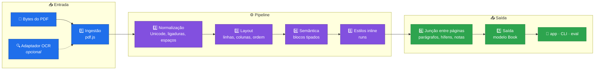

<div align="center">

# 📖 PagePace

### PDF entra, texto fluido sai

*O PagePace reconstrói um PDF como um documento estruturado e fluido — parágrafos, títulos, notas e estilos — e o lê como texto, em vez de mostrar a página do PDF.*

[**Read in English**](README.md)

<!-- hero image goes here -->


</div>

---

## 📑 Índice

| | |
|---|---|
| [🎯 O problema](#-o-problema) | [📈 Qualidade](#-qualidade) |
| [🏗️ Arquitetura](#️-arquitetura) | [📁 Estrutura do repositório](#-estrutura-do-repositório) |
| [⚡ Começo rápido](#-começo-rápido) | [🗺️ Roadmap](#️-roadmap) |
| [🖥️ A linha de comando](#️-a-linha-de-comando) | [🛠️ Como é feito](#️-como-é-feito) |
| [📚 Documentação](#-documentação) | [🙏 Agradecimentos](#-agradecimentos) |

---

## 🎯 O problema

PDFs são feitos para impressão, não para leitura profunda. No celular é pior: zoom, arrastar, perder o lugar. A tabela abaixo mostra o que dá errado numa página de PDF e o que o extrator faz a respeito hoje.

| 🔴 O PDF como foi impresso | ✅ O que o PagePace faz |
|---|---|
| **Páginas fixas** — cada página é uma tela de tamanho fixo; no celular o texto fica minúsculo ou cortado | O texto vira blocos tipados em ordem de leitura; a geometria da página sobrevive só como metadado `origin`, então o texto pode fluir para qualquer tela (o app de leitura ainda é planejado) |
| **Colunas** — duas ou três colunas são lidas linha a linha, atravessando a calha, na ordem errada | Até três colunas são detectadas por página e lidas na ordem de leitura correta |
| **Notas no rodapé** — as notas ficam no pé da página, longe da chamada que aponta para elas | Blocos `footnote` são ligados à sua chamada (`anchor` e `noteRef`) |
| **Hifenização** — palavras são quebradas por hífen na quebra de linha, e parágrafos são cortados na virada de página | Junções entre páginas remontam palavras hifenizadas e parágrafos; hifens genuínos de palavras compostas são preservados |
| **Cabeçalhos repetidos** — títulos correntes, rodapés e números de página se repetem dentro do fluxo do texto | Regiões repetidas são removidas do fluxo, e regiões laterais ficam fora do corpo |

> [!NOTE]
> **Status:** o extrator (`packages/extractor`, fases E0–E10) e o segmentador (`packages/segmenter`, fase SEG) estão completos e testados. O app de leitura (`apps/reader`) **não começou** — está planejado em marcos M0–M6. Hoje o PagePace é uma biblioteca e uma linha de comando.

> [!IMPORTANT]
> **Nenhum PDF com direitos autorais neste repositório.** Os PDFs públicos de teste são baixados por um script, nunca versionados; os únicos PDFs versionados são os dois artigos do SciELO em CC BY 4.0, em `corpus/vendored/`. Livros com direitos autorais ficam **fora** do repositório, na pasta indicada por `CORPUS_PRIVATE_DIR`. Nunca anexe um PDF com direitos autorais nem o texto dele a um commit, issue ou pull request.

---

## 🏗️ Arquitetura

As sete camadas do extrator — cada uma uma função pura com tipos explícitos, testável sozinha com fixtures pequenas:



O `Book` é o contrato entre o extrator e todo o resto: blocos tipados com IDs estáveis, estilos inline, origem na página, confiança e flags. Detalhes: [docs/extractor/ARCHITECTURE.md](docs/extractor/ARCHITECTURE.md) e [docs/extractor/SCHEMA.md](docs/extractor/SCHEMA.md).

---

## ⚡ Começo rápido

Requisitos: **Node >= 24** (a versão exata está em [`.nvmrc`](.nvmrc)) e **pnpm 9.15.0** (fixado no campo `packageManager` do [`package.json`](package.json)).

```bash
pnpm install --frozen-lockfile
pnpm corpus:fetch   # a primeira execução baixa os PDFs públicos de teste
pnpm verify         # typecheck, lint, formato, testes, checagem de PDF e orçamento de docs
```

O corpus público está descrito em [corpus/README.md](corpus/README.md); a pasta privada é opcional.

---

## 🖥️ A linha de comando

```bash
pnpm --silent pagepace inspect corpus/vendored/n3-pt-scielo-wittgenstein.pdf --pages 2-2
```

O relatório abaixo são as 12 primeiras linhas de uma execução real:

```text
Arquivo: corpus/vendored/n3-pt-scielo-wittgenstein.pdf
Páginas medidas: 11 de 11
Itens de texto: 967
Páginas no relatório: 2
Corpo (moda ponderada): 12.00 pt
Entrelinha típica: 14.40 pt
Margens: topo 34.76 pt · direita 56.51 pt · base 37.21 pt · esquerda 56.69 pt
Largura de coluna: 482.19 pt

== Página 2 (7 bloco(s)) ==
[p1-b0-16717eaf] paragraph · páginas 2 · confiança 0.90 · flags: nenhuma
Descartes, instado por objetores, esclarecia a função metódica da dúvida através de uma analogia bastante eloquente: "Se vós tivésseis um cesto de maçãs dentre as quais várias estivessem podres, contaminando assim as restantes, o que fazer senão esvaziá-lo todo e, tomando cada maçã, uma a uma, recolocar as boas no cesto e jogar fora as más?" (Respostas às sétimas objeções, p. 324). Ou seja, a ideia é que o ceticismo epistemológico cumpre uma espécie de função profilática, funcionando como um filtro que é útil para separar o que é verdadeiro e certo do que é falso e duvidoso.
```

O `extract` imprime o `Book` inteiro em JSON. O trecho abaixo é de uma execução real, cortado em 15 linhas, mostrando o fim de um bloco e o começo do seguinte:

```bash
pnpm --silent pagepace extract corpus/vendored/n3-pt-scielo-wittgenstein.pdf > book.json
```

```json
        "originalPageLabel": "1"
      },
      "confidence": 0.9,
      "flags": []
    },
    {
      "id": "p0-b0-645288ef",
      "kind": "heading",
      "level": 1,
      "runs": [
        {
          "text": "Artigo",
          "bold": true,
          "sup": true
        }
```

A saída da linha de comando é em **português**. "Wittgenstein e o ceticismo", de Daniel Temp, *Filosofia Unisinos* 27(1) (2026), e27103, DOI [10.4013/fsu.2026.271.03](https://doi.org/10.4013/fsu.2026.271.03) — © dos autores, licenciado em [CC BY 4.0](https://creativecommons.org/licenses/by/4.0/). O arquivo é uma cópia byte a byte em `corpus/vendored/`; detalhes em [THIRD_PARTY.md](THIRD_PARTY.md).

> [!TIP]
> Use `pnpm --silent` para esconder o aviso do pnpm, para que só o relatório ou o JSON chegue ao terminal.

> [!WARNING]
> Um PDF sem camada de texto é recusado pelo caminho padrão (`ScannedPdfError`). O OCR é opcional: `pnpm pagepace extract arquivo.pdf --ocr` usa o adaptador Tesseract. Texto vindo de uma camada de OCR embutida é extraído com confiança reduzida e um aviso, porque os caracteres podem estar errados.

---

## 📈 Qualidade

O `pnpm eval` mede o extrator contra documentos gabarito. Esta é a saída de uma execução real só com o corpus público (sem pasta privada configurada) — exatamente o que um clone novo reproduz:

```text
PagePace evaluation - 16 documents (16 public, 0 private), 12 with golden, 12 measured

By level (mean of the measured documents)
level  documents  measured  text_cer (mean)  style_f1 (mean)
-----  ---------  --------  ---------------  ---------------
N1             5         4           0.0000           1.0000
N2             6         5           0.0000           1.0000
N3             5         3           0.0000           0.9983
```

- **Testes golden** são arquivos JSON de saída esperada (`corpus/golden/*.golden.json`) para documentos cuja especificação *é* a verdade — os 12 PDFs sintéticos `syn-*`, gerados por `pnpm corpus:synthetic`. Toda métrica compara a extração com eles.
- **Baseline e a regra de não regressão:** [packages/eval/baseline.json](packages/eval/baseline.json) registra o valor aceito de cada métrica por documento. O `pnpm eval --ci` (rodado pelo CI em todo pull request) **falha se qualquer métrica piorar mais que 0,002**.
- Uma piora deliberada exige uma ADR em [docs/extractor/DECISIONS.md](docs/extractor/DECISIONS.md) e uma atualização explícita do baseline. Todas as outras métricas são `1,0000` nos 12 documentos medidos, exceto `style_f1` em `syn-n3-en-quotes` (`0,9950`), que define a média do N3 em `0,9983`.

---

## 📁 Estrutura do repositório

```text
PagePace/
├── 📦 packages/            pacotes do workspace
│   ├── schema/             o contrato de dados: RawDocument, Book, Anchor, Overlay
│   ├── extractor/          o pipeline de sete camadas, de PDF a Book
│   ├── segmenter/          frases e palavras determinísticas, pt e en
│   ├── eval/               runner do corpus, métricas e o portão do baseline
│   └── cli/                pagepace extract · inspect · explain-page · eval
├── 📱 apps/                o app de leitura — planejado, não iniciado
├── 📚 corpus/              manifest, gabaritos, frases, PDFs CC BY versionados
├── 📖 docs/                planejamento, fases, ADRs e o processo de trabalho
├── 🧪 tests/manual/        checklists visuais que um humano roda ao fechar cada marco
├── 🤖 .opencode/           skills (receitas reutilizáveis) para os agentes de IA
├── ⚙️ scripts/             pequenos utilitários do repositório
└── 🔧 .github/             workflow do CI, modelos de issue e de pull request
```

---

## 🗺️ Roadmap

- [x] **Extrator** — fases E0–E10 fechadas: sete camadas, blocos tipados, estilos inline, junções entre páginas, notas, confiança e flags
- [x] **Segmentador** — fase SEG fechada: frases e palavras determinísticas para português e inglês
- [ ] **M0 · Spikes e arquitetura** — decidir alvo no PC (site ou local), armazenamento e TTS; escrever os planos das fases M1–M6
- [ ] **M1 · Casca do app** — projeto TypeScript + Capacitor, biblioteca, adicionar PDF → extrair (em streaming) → salvar o `Book`; temas
- [ ] **M2 · Leitura dinâmica (celular)** — tela de preparação, palavra por palavra com ORP e ritmo proporcional, trechos de frase/parágrafo/página, controles, pausa, salvar posição
- [ ] **M3 · Leitura normal + anotações** — paginador, subpáginas, marca-texto/sublinhado/anotação, salvamento automático, régua de foco, tela de correção
- [ ] **M4 · PC** — layout de duas páginas, contexto inferior durante a leitura, atalhos, anotações ao passar o mouse
- [ ] **M5 · TTS** — adaptador TTS, destaque da palavra, velocidade; avaliar voz local
- [ ] **M6 · Extras** — OCR, pacer-fade, Bionic opcional, exportação Markdown das anotações, sincronização

Os marcos do app estão definidos em [docs/app/ROADMAP.md](docs/app/ROADMAP.md); cada um será quebrado em fases e tarefas atômicas durante o M0.

---

## 🛠️ Como é feito

| Pilar | Na prática | Onde |
|---|---|---|
| **ADRs** | Toda escolha entre alternativas, dependência ou troca aceita é registrada, então quem continua lê o *porquê*, não um palpite | [docs/extractor/DECISIONS.md](docs/extractor/DECISIONS.md) |
| **Portões de CI** | Lint, formato, typecheck, a suíte de testes inteira, a checagem de PDF, o orçamento de docs, `pnpm eval --ci` (portão de regressão das métricas) e `pnpm bench --ci` (alarme de velocidade e memória) | [.github/workflows/ci.yml](.github/workflows/ci.yml) |
| **Métricas** | Mudanças na extração só são aceitas se a avaliação do corpus não regredir além da tolerância de 0,002 | [docs/extractor/EVALUATION.md](docs/extractor/EVALUATION.md) |

O processo está em [docs/WORKFLOW.md](docs/WORKFLOW.md): tarefas pequenas e atômicas, teste primeiro quando possível, `pnpm verify` verde, pull request, squash merge. Regras para contribuir: [CONTRIBUTING.md](CONTRIBUTING.md).

---

## 📚 Documentação

Tudo em `docs/` é escrito em português. A tabela abaixo aponta cada mapa.

<details>
<summary><b>📖 Mapa da documentação</b></summary>

| Eu quero… | Leia |
|---|---|
| Entender o projeto | [docs/extractor/PROJECT.md](docs/extractor/PROJECT.md) |
| Entender o extrator | [docs/extractor/ARCHITECTURE.md](docs/extractor/ARCHITECTURE.md), [docs/extractor/SCHEMA.md](docs/extractor/SCHEMA.md) |
| Ver o plano | [docs/extractor/ROADMAP.md](docs/extractor/ROADMAP.md), fases em `docs/extractor/phases/` |
| Ver como a qualidade é medida | [docs/extractor/EVALUATION.md](docs/extractor/EVALUATION.md), [corpus/README.md](corpus/README.md) |
| Ver por que as decisões foram tomadas | [docs/extractor/DECISIONS.md](docs/extractor/DECISIONS.md) (registro de ADRs) |
| Entender o processo de trabalho | [docs/WORKFLOW.md](docs/WORKFLOW.md), [AGENTS.md](AGENTS.md) |
| Entender o plano do app | [docs/app/PROJECT.md](docs/app/PROJECT.md), [docs/app/ROADMAP.md](docs/app/ROADMAP.md) |
| Contribuir | [CONTRIBUTING.md](CONTRIBUTING.md) |

Comece em [docs/README.md](docs/README.md).

</details>

<details>
<summary><b>⚠️ Limitações conhecidas</b></summary>

- Blocos `figure`, `table` e `equation` são detectados e guardados como **placeholders** (sem runs) — o conteúdo deles ainda não é reconstruído.
- Um PDF **sem camada de texto** falha no caminho padrão (`ScannedPdfError`); o OCR é um adaptador de ingestão opcional (`ingestOcrFlow`, `pagepace extract --ocr`).
- Texto vindo de uma **camada de OCR embutida** é extraído com confiança reduzida e um aviso.
- O **app de leitura** não começou: ainda não existe tela para ler um `Book`.

</details>

<details>
<summary><b>🗂️ Mapa do repositório</b></summary>

| Caminho | O que é |
|---|---|
| `packages/` | `schema` (o contrato), `extractor`, `segmenter`, `eval`, `cli` |
| `apps/` | o app de leitura — planejado, não iniciado ([docs/app/ROADMAP.md](docs/app/ROADMAP.md)) |
| `corpus/` | documentos de teste: manifest, gabaritos, PDFs CC BY versionados (PDFs públicos são baixados, nunca versionados) |
| `docs/` | documentação de planejamento e processo, em português |
| `scripts/` | pequenos utilitários do repositório (orçamento de docs, política de e-mail, assets do pdf.js) |
| `tests/manual/` | checklists visuais que um humano roda ao fim de cada marco |
| `.opencode/` | skills (receitas reutilizáveis) para os agentes de IA que trabalham aqui |
| `.github/` | workflow do CI, modelos de issue e de pull request |

</details>

---

## 🙏 Agradecimentos

- [pdf.js](https://mozilla.github.io/pdf.js/) (Apache-2.0) — ingestão do PDF, roda no navegador e no Node.
- [tesseract.js](https://github.com/naptha/tesseract.js) (Apache-2.0) — adaptador do motor de OCR.
- [zod](https://zod.dev/) (MIT) — validação em tempo de execução do contrato de dados.
- [Source Serif 4](https://adobe-fonts.github.io/source-serif/) (SIL OFL 1.1) — fontes de teste usadas pela suíte de testes.
- Daniel Temp e Milene Consenso Tonetto, autores dos dois artigos do SciELO em CC BY 4.0 usados como fixtures de teste.

Licenças e atribuições de tudo que vive ou é distribuído com este repositório: [THIRD_PARTY.md](THIRD_PARTY.md).

---

**PagePace** · [Licença MIT](LICENSE) · 2026
