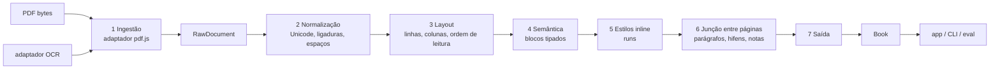

# PagePace

[Read in English](README.md)

PagePace reconstrói um PDF como documento estruturado e reflowable e lê o texto de volta — parágrafos, títulos, notas e estilos — em vez de mostrar a página do PDF.

[](https://github.com/Rennan-aex/PagePace/actions/workflows/ci.yml)
[](LICENSE)
[](.nvmrc)

## Status

| Componente | Estado |
|---|---|
| `packages/extractor` (PDF → modelo) | **Completo e testado** — fases E0–E10 encerradas, ver [docs/extractor/ROADMAP.md](docs/extractor/ROADMAP.md) |
| `packages/segmenter` (frases e palavras, pt/en) | **Completo e testado** — trilha SEG encerrada |
| `apps/reader` (o app leitor) | **Ainda não iniciado** — só planejado, ver [docs/app/ROADMAP.md](docs/app/ROADMAP.md) |

Os números desta página vêm de execuções reais dos comandos mostrados (`pnpm eval`, `pnpm verify`) numa máquina de desenvolvimento; nada aqui foi escrito à mão.

## Por quê

PDFs foram feitos para impressão, não para leitura profunda: páginas fixas, duas colunas, notas de rodapé embaixo, linhas quebradas por hífen, cabeçalhos repetidos em toda página. No celular fica pior — zoom, perda do lugar.

O PagePace extrai o PDF **uma vez** para um modelo intermediário (`Book`: blocos tipados com estilos inline, IDs estáveis, confiança) e todos os modos de leitura consomem esse modelo. A página do PDF nunca é renderizada ao leitor; o texto pode se adaptar a qualquer tela, e as correções do leitor (juntar, separar, mudar o tipo) ficam em um overlay separado que sobrevive à reextração.

## O que o extrator reconhece

Somente o que o código faz hoje — conferido em [docs/extractor/ARCHITECTURE.md](docs/extractor/ARCHITECTURE.md) e [docs/extractor/SCHEMA.md](docs/extractor/SCHEMA.md):

- **Tipos de bloco** (`BlockKind`): `heading` (níveis 1–6), `paragraph`, `blockquote`, `epigraph`, `list_item`, `footnote` (ligado à sua chamada), `reference`, `caption`, `figure`, `table`, `equation`, `code`, `margin_ref` (numeração editorial como Bekker/Stephanus, mantida fora do fluxo de leitura).
- **Layout**: linhas de texto, até três colunas com ordem de leitura, regiões repetidas (cabeçalhos, rodapés, números de página) removidas do fluxo, regiões laterais e junções entre páginas de parágrafos e palavras hifenizadas.
- **Estilos inline**: negrito, itálico, sobrescrito, subescrito e versalete recuperados de nomes e flags da fonte; trechos gregos/latinos marcados com `lang`.
- **Nível do documento**: sumário a partir dos bookmarks do PDF, metadados de título/autores/idioma e, por bloco, `confidence` mais `flags` com todos os motivos de dúvida.
- **Limites honestos**: os blocos `figure`, `table` e `equation` são detectados e carregados como *placeholders* (sem runs) — o conteúdo deles ainda não é reconstruído. Um PDF escaneado sem camada de texto é recusado (`ScannedPdfError`, aguardando OCR); texto vindo de camada de OCR embutida é extraído com confiança reduzida e aviso.

## Arquitetura

As sete camadas de [docs/extractor/ARCHITECTURE.md](docs/extractor/ARCHITECTURE.md) — cada uma uma função pura com tipos explícitos:



## Primeiros passos

Requisitos: **Node >= 24** (a versão exata está em [`.nvmrc`](.nvmrc)) e **pnpm 9** (fixado no campo `packageManager` do [`package.json`](package.json)).

```bash
pnpm install --frozen-lockfile   # 0,8 s (execução com tudo já instalado)
pnpm corpus:fetch                # 1,9 s (16 arquivos em cache, sem download)
pnpm verify                      # 41,6 s: typecheck, lint, formatação, 1406 testes, checagem de PDFs, orçamento de docs
```

Tempos medidos nesta máquina com tudo já instalado (`pnpm install` imprime "Done in 684ms"; `corpus:fetch` reporta `16 public (… 16 reused)`). O **primeiro** `pnpm corpus:fetch` baixa o corpus público de testes pela rede e demora mais; as execuções seguintes só conferem o SHA-256 de cada arquivo. O `pnpm verify` precisa estar verde antes de qualquer pull request — ver [CONTRIBUTING.md](CONTRIBUTING.md).

## Exemplo: a CLI num PDF do corpus

```bash
pnpm --silent pagepace inspect corpus/vendored/n3-pt-scielo-wittgenstein.pdf --pages 2-2
```

Primeiras 12 linhas de uma execução real (`--silent` esconde o banner do pnpm, para só o relatório chegar ao terminal):

```text
Arquivo: corpus/vendored/n3-pt-scielo-wittgenstein.pdf
Páginas medidas: 11 de 11
Itens de texto: 967
Páginas no relatório: 2
Corpo (moda ponderada): 12.00 pt
Entrelinha típica: 14.40 pt
Margens: topo 34.76 pt · direita 56.51 pt · base 37.21 pt · esquerda 56.69 pt
Largura de coluna: 482.19 pt

== Página 2 (7 bloco(s)) ==
[p1-b0-16717eaf] paragraph · páginas 2 · confiança 0.90 · flags: nenhuma
Descartes, instado por objetores, esclarecia a função metódica da dúvida através de uma analogia bastante eloquente: "Se vós tivésseis um cesto de maçãs dentre as quais várias estivessem podres, contaminando assim as restantes, o que fazer senão esvaziá-lo todo e, tomando cada maçã, uma a uma, recolocar as boas no cesto e jogar fora as más?" (Respostas às sétimas objeções, p. 324). Ou seja, a ideia é que o ceticismo epistemológico cumpre uma espécie de função profilática, funcionando como um filtro que é útil para separar o que é verdadeiro e certo do que é falso e duvidoso.
```

"Wittgenstein e o ceticismo" de Daniel Temp, *Filosofia Unisinos* 27(1) (2026), e27103, DOI [10.4013/fsu.2026.271.03](https://doi.org/10.4013/fsu.2026.271.03) — © os autores, licenciado sob [CC BY 4.0](https://creativecommons.org/licenses/by/4.0/). O arquivo é uma cópia byte a byte em `corpus/vendored/`; detalhes em [THIRD_PARTY.md](THIRD_PARTY.md).

## Qualidade

O `pnpm eval` mede o extrator contra documentos golden (saída esperada gravada ao lado do corpus). Saída de uma execução real nesta máquina:

```text
PagePace evaluation - 31 documents (16 public, 15 private), 12 with golden, 12 measured

By level (mean of the measured documents)
level  documents  measured  text_cer (mean)  style_f1 (mean)
-----  ---------  --------  ---------------  ---------------
N1            10         4           0.0000           1.0000
N2             8         5           0.0000           1.0000
N3             8         3           0.0000           0.9983
N4             3         0                -                -
N5             2         0                -                -
```

- **Testes golden** são arquivos JSON de saída esperada (`corpus/golden/*.golden.json`) para documentos cuja especificação *é* a verdade — hoje os 12 PDFs sintéticos `syn-*`, gerados por `pnpm corpus:synthetic`. Toda métrica compara a extração com eles; os PDFs reais são exercitados pelos testes de aceite em `packages/*/test/`.
- As demais métricas são `1.0000` nos 12 documentos medidos, exceto `style_f1` em `syn-n3-en-quotes` (`0.9950`), que derruba a média de N3 para `0.9983`. A segmentação de frases é medida à parte em quatro textos de domínio público: `sentence_f1 1.0000` (meta ≥ 0,97).
- **Baseline e a regra sem regressão:** [packages/eval/baseline.json](packages/eval/baseline.json) guarda o valor aceito de cada métrica por documento. O `pnpm eval --ci` (rodo pelo CI em todo pull request) **falha se alguma métrica piorar mais de 0,002**. Piora de propósito exige um ADR em [docs/extractor/DECISIONS.md](docs/extractor/DECISIONS.md) e atualização explícita da baseline. Detalhes: [docs/extractor/EVALUATION.md](docs/extractor/EVALUATION.md).

## Mapa do repositório

| Caminho | O que é |
|---|---|
| `packages/` | `schema` (o contrato), `extractor`, `segmenter`, `eval`, `cli` |
| `apps/` | o app leitor — planejado, não iniciado ([docs/app/ROADMAP.md](docs/app/ROADMAP.md)) |
| `corpus/` | documentos de teste: manifest, goldens, PDFs vendored (os públicos são baixados, nunca commitados) |
| `docs/` | documentação de planejamento e processo, em português |
| `scripts/` | utilitários pequenos do repositório (orçamento de docs, índice de decisões, assets do pdf.js) |
| `tests/manual/` | checklists visuais executados por um humano ao fim de cada marco |
| `.opencode/` | skills (receitas reutilizáveis) para as agentes de IA que trabalham aqui |
| `.github/` | workflow de CI, templates de issue e de pull request |

## Documentação

Tudo em `docs/` está escrito em português; comece por [docs/README.md](docs/README.md).

| Quero… | Leia |
|---|---|
| Entender o projeto | [docs/extractor/PROJECT.md](docs/extractor/PROJECT.md) |
| Entender o extrator | [docs/extractor/ARCHITECTURE.md](docs/extractor/ARCHITECTURE.md), [docs/extractor/SCHEMA.md](docs/extractor/SCHEMA.md) |
| Ver o plano | [docs/extractor/ROADMAP.md](docs/extractor/ROADMAP.md), fases em `docs/extractor/phases/` |
| Ver como a qualidade é medida | [docs/extractor/EVALUATION.md](docs/extractor/EVALUATION.md), [corpus/README.md](corpus/README.md) |
| Ver por que as decisões foram tomadas | [docs/extractor/DECISIONS.md](docs/extractor/DECISIONS.md) (registro de ADRs) |
| Entender o processo de trabalho | [docs/WORKFLOW.md](docs/WORKFLOW.md), [AGENTS.md](AGENTS.md) |
| Entender o plano do app | [docs/app/PROJECT.md](docs/app/PROJECT.md), [docs/app/ROADMAP.md](docs/app/ROADMAP.md) |
| Contribuir | [CONTRIBUTING.md](CONTRIBUTING.md) |

## Como é construído

O PagePace é desenvolvido com **agentes de IA** (um por vez, com passagem de bastão registrada em `STATE.md`) sob o processo de [docs/WORKFLOW.md](docs/WORKFLOW.md): tarefas atômicas pequenas, teste primeiro quando possível, `pnpm verify` verde, pull request, squash merge.

Três coisas mantêm o trabalho honesto:

- **ADRs** — toda escolha entre alternativas, dependência ou trade-off aceito é escrito em [docs/extractor/DECISIONS.md](docs/extractor/DECISIONS.md) (mais de 100 entradas), para que o próximo contribuidor leia o *porquê*, não um chute.
- **Gates de CI** — [`.github/workflows/ci.yml`](.github/workflows/ci.yml) roda lint, formatação, typecheck, a suíte de testes inteira, a checagem de PDFs, o orçamento de docs, `pnpm eval --ci` (gate de regressão de métricas) e `pnpm bench --ci` (alarme de velocidade/memória).
- **Métricas** — mudanças na extração só são aceitas se a avaliação do corpus não regredir (ver *Qualidade* acima).

## Contribuindo

Leia [CONTRIBUTING.md](CONTRIBUTING.md). Em resumo: Node do `.nvmrc`, `pnpm install`, `pnpm corpus:fetch`, `pnpm verify` verde, pull requests pequenos, Conventional Commits em inglês, sem regressão de métricas e **nunca** anexar PDFs ou texto com copyright em commits, issues ou pull requests.

## Licença

[MIT](LICENSE).

## Agradecimentos

- [pdf.js](https://mozilla.github.io/pdf.js/) (Apache-2.0) — ingestão de PDF, roda no navegador e no Node.
- [tesseract.js](https://github.com/naptha/tesseract.js) (Apache-2.0) — motor de OCR (adaptador).
- [zod](https://zod.dev/) (MIT) — validação em runtime do contrato de dados.
- [Source Serif 4](https://adobe-fonts.github.io/source-serif/) (SIL OFL 1.1) — fontes de teste usadas pela suíte de testes.
- Daniel Temp e Milene Consenso Tonetto, autores dos dois artigos SciELO com licença CC BY 4.0 usados como fixtures de teste.

Licenças e atribuições de tudo que vive ou é distribuído com este repositório: [THIRD_PARTY.md](THIRD_PARTY.md).
